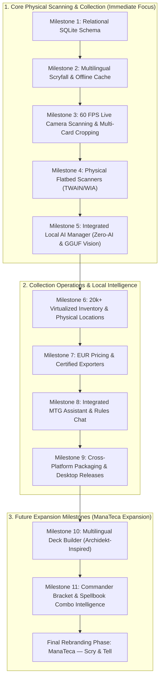
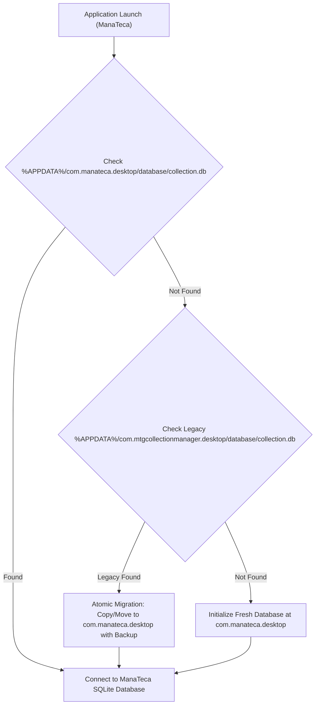

# ManaTeca — Scry & Tell

## Technical Specification: Multilingual Deck Builder, Commander Intelligence & Rebranding Roadmap

- **Document Version:** 1.0.0
- **Date:** November 1, 2026
- **Provisional Brand:** ManaTeca — Scry & Tell
- **Current Technical Identity:** `MTG Collection Manager` (`com.mtgcollectionmanager.desktop`)
- **Status:** Approved for Future Milestones (Milestones 10, 11 & Final Rebranding)

---

## 1. Product Vision & Priority Hierarchy

The core mission of **ManaTeca — Scry & Tell** is to provide a complete, private, and offline-first ecosystem for Magic: The Gathering collectors and players.

### Strategic Priorities



> [!IMPORTANT]
> The primary focus of the application remains **scanning, recognizing, and cataloging physical Magic cards**. Milestones 10 and 11 represent future capabilities that build upon the stable inventory, local AI, and Scryfall engine, without delaying camera or flatbed hardware integration.

---

## 2. Milestone 10: Multilingual Deck Builder

Inspired by the workflow and visual usability of Archidekt, ManaTeca will provide an integrated, responsive deck-building suite that directly interfaces with the user's private physical inventory.

### 2.1 Supported Game Formats & Deck Rules

- **Commander / EDH & Duel Commander:** 100-card singleton, Commander / Partner / Background / Friends Forever selection, Color Identity validation.
- **Constructed 60-Card Formats:** Standard, Modern, Pioneer, Legacy, Vintage, Pauper (60-card mainboard + 15-card sideboard, maximum 4 copies rule).
- **Casual & Specialty Formats:** Oathbreaker (Signature Spell + Planeswalker), Premodern, Canadian Highlander, Brawl.

### 2.2 Multilingual Card Search & Printing Disambiguation

Users must be able to search and add cards using localized card names across all 18 supported languages:

- **Italian:** *"Fulmine"* $\rightarrow$ Lightning Bolt, *"Contromagia"* $\rightarrow$ Counterspell.
- **French:** *"Foudre"* $\rightarrow$ Lightning Bolt, *"Contresort"* $\rightarrow$ Counterspell.
- **German, Spanish, Portuguese, Japanese, Korean, Russian, Chinese.**

#### Architectural Separation of Concerns

1. **Canonical Oracle Identity:** The deck rules engine evaluates legality, color identity, mana value, and singleton limits strictly using the English canonical Oracle record.
2. **Physical Printing & Language Selection:** When adding a card, the user can attach a specific physical printing (`set_code`, `collector_number`, `lang`, `finish`).
3. **No Language Fragmentation:** Selecting an Italian printing (`CLB #187 [IT]`) and an English printing (`LEA #1 [EN]`) of Lightning Bolt evaluates to the exact same canonical card identity without violating deck-building rules.

### 2.3 Two-Way Collection & Inventory Integration

The Deck Builder communicates with the SQLite inventory via relational deck-card links:

```sql
-- Planned Schema for Milestone 10: Decks & Deck Items
CREATE TABLE IF NOT EXISTS decks (
    id TEXT PRIMARY KEY,
    name TEXT NOT NULL,
    format TEXT NOT NULL,
    commander_card_id TEXT REFERENCES cards(id),
    secondary_commander_card_id TEXT REFERENCES cards(id),
    description TEXT,
    folder_path TEXT DEFAULT '/',
    tags TEXT,
    created_at TEXT NOT NULL,
    updated_at TEXT NOT NULL
);

CREATE TABLE IF NOT EXISTS deck_cards (
    id TEXT PRIMARY KEY,
    deck_id TEXT NOT NULL REFERENCES decks(id) ON DELETE CASCADE,
    card_id TEXT NOT NULL REFERENCES cards(id),
    printing_id TEXT REFERENCES printings(id),
    category TEXT NOT NULL DEFAULT 'Mainboard',
    quantity INTEGER NOT NULL CHECK (quantity > 0),
    is_commander BOOLEAN DEFAULT FALSE,
    is_sideboard BOOLEAN DEFAULT FALSE,
    is_maybeboard BOOLEAN DEFAULT FALSE,
    assigned_inventory_item_id TEXT REFERENCES inventory_items(id) ON DELETE SET NULL,
    created_at TEXT NOT NULL,
    updated_at TEXT NOT NULL
);
```

- **Owned vs. Missing Tracking:** Automatically compares the cards required in a deck with the available copies in `inventory_items`. Cards not currently in inventory are flagged as "Missing / Needed".
- **Physical Allocation:** A physical card in inventory can be assigned to one or more virtual decks without duplicating physical stock.
- **Deck Deletion Safety:** Deleting a deck never deletes or reduces the underlying inventory copies.

### 2.4 Visual & Tabular Workspace Modes

- **Visual Grid Mode:** Fluid drag-and-drop workspace grouping cards by custom categories (e.g., *Ramp*, *Card Draw*, *Single Target Removal*, *Board Wipes*, *Win Conditions*, *Mana Base*).
- **Tabular / List Mode:** Fast, keyboard-navigable spreadsheet view for bulk quantity adjustments, condition checks, and price tracking.
- **Deck Analytics:**
  - Dynamic Mana Curve (0 to 7+ mana value).
  - Color Pips vs. Mana Production distribution.
  - Type Distribution (Creatures, Instants, Sorceries, Artifacts, Enchantments, Planeswalkers, Lands).
  - Average Mana Value with and without lands.
  - Estimated Budget & Market Value (EUR / USD from Scryfall & Cardmarket).

---

## 3. Milestone 11: Commander Bracket & Combo Intelligence

### 3.1 Official Commander Bracket Classification System

The system integrates the official 5-tier Commander Bracket framework established by Wizards of the Coast and the Commander Rules Committee:

| Bracket Tier | Name | Key Characteristics & Criteria |
| :---: | :---: | :--- |
| **Bracket 1** | **Exhibition** | Preconstructed, casual theme decks, jank, highly unoptimized mana bases, minimal or zero tutors. |
| **Bracket 2** | **Core** | Standard casual Commander: thematic synergy, focused game plan, precon upgrades, moderate interaction speed. |
| **Bracket 3** | **Upgraded** | High synergy, optimized dual/fetch mana bases, efficient removal suites, deliberate win conditions, moderate tutoring. |
| **Bracket 4** | **Optimized** | High-power EDH: fast mana (Mana Crypt, Mox Diamond, Sol Ring), efficient tutors, compact infinite combos, mass land denial. |
| **Bracket 5** | **cEDH** | Competitive EDH: turn 1–3 win capability, maximum density of free interaction, Thoracle/Consultation lines, zero compromise for speed. |

#### Advisory & Explainable Evaluation

- **No Infallible Dogma:** The bracket evaluation is purely advisory. The application provides an explicit breakdown explaining *why* a deck is categorized in a given bracket (e.g., *"Detected 3 Game Changers: Demonic Tutor, Mana Crypt, Rhystic Study; 1 verified 2-card infinite combo"*).
- **Source Versioning:** Bracket criteria, Game Changers lists, and fast mana definitions are versioned with effective publication dates (e.g., `WotC Commander Guidance: September 2024 / Q1 2026`). Reference data can be updated without recompiling the application binary.
- **Manual Adjustment:** Users can override the advisory bracket to match their local playgroup's rule 0 consensus.

### 3.2 Combo & Synergy Recognition Engine (Commander Spellbook Integration)

ManaTeca integrates with the open-source dataset provided by **Commander Spellbook** (<https://commanderspellbook.com/>):

#### Legal & Architectural Constraints

- **Licensing Compliance:** Prior to production ingestion, the application verifies Commander Spellbook's open data licensing, attribution requirements, and API distribution restrictions. No unauthorized web scraping is performed.
- **Offline / Structured Dataset:** Combo definitions are stored in a structured local SQLite table, enabling instant offline detection when analyzing decklists.
- **Role of Generative AI:** On-device AI may assist in phrasing step-by-step combo execution for user readability, but **is strictly forbidden from hallucinating or inventing unverified game combos**. All combos must map to verified rules records.

#### Combo Classification Hierarchy

1. **Verified Infinite Combos:** Infinite mana, infinite damage, infinite card draw, infinite tokens, infinite turns, infinite ETB/death triggers.
2. **Two-Card Combos:** Compact interactions (e.g., *Thassa's Oracle + Demonic Consultation*, *Heliod, Sun-Crowned + Walking Ballista*).
3. **Multi-Card Combos:** Sequences requiring 3+ specific pieces on the battlefield or in graveyard.
4. **Conditional Combos:** Combos requiring specific board states (e.g., opponent life total thresholds, specific land counts).
5. **Strong Synergies:** Powerful non-infinite engines (e.g., *Seedborn Muse + Thrasios, Triton Hero*).
6. **Incomplete Combos:** Highlights combos where the user owns 2 of 3 required cards, with a single-click option to add the missing card to the wishlist.

#### Detailed Combo Presentation

For every detected combo, the user can inspect:

- Cards involved with interactive image zoom.
- Total mana required to cast and initiate.
- Prerequisite board/graveyard setup.
- Sequential step-by-step rules execution.
- Resulting infinite/finite game output.

---

## 4. Final Rebranding Phase: ManaTeca — Scry & Tell

### 4.1 Product Identity Transition

Once core scanning, inventory, deck building, and local AI capabilities have matured, the application will undergo a formal public rebranding:

- **New Name:** **ManaTeca — Scry & Tell**
- **Brand Essence:** *Mana* (magical energy) + *Teca* (from Greek *thēkē*, repository/treasury/library) — the definitive sanctuary for physical Magic collections. Subtitle: *Scry & Tell* (instant visual identification and explainable rules intelligence).
- **Public Assets:** Window titles, visual logo, desktop/start menu shortcuts, installer banners, bilingual documentation, and GitHub repository naming.

### 4.2 Critical Technical Requirement: Database Continuity & Path Discovery

Existing users must never experience data loss during the rebranding transition.



#### Backward Compatibility Safeguards

1. **Fallback Discovery:** The Tauri backend will inspect the legacy path (`com.mtgcollectionmanager.desktop`) before creating a new database.
2. **Safe Migration:** When a legacy database is detected, the application creates a verified timestamped backup before linking or migrating data to the new path.
3. **Current State:** The application retains `com.mtgcollectionmanager.desktop` as its official identifier throughout Milestones 2 through 9.

---

## 5. Summary of Milestones & Dependencies

| Milestone | Scope | Technical Dependencies | Status |
| :---: | :--- | :--- | :---: |
| **Milestone 0** | Project setup, CI, license, NOTICE, documentation | GitHub Actions, Git | :white_check_mark: Completed |
| **Milestone 1** | Tauri 2 + React 19 + SQLite relational schema | rusqlite, migrations v1-v3 | :white_check_mark: Completed |
| **Milestone 2** | Scryfall async client, multilingual search, image cache & zoom | Scryfall API, schema v4, ImageCacheManager | :white_check_mark: Completed (`feature/milestone-2-scryfall`) |
| **Milestone 3** | 60 FPS camera scanner, stability lock, multi-card crop | OpenCV, Web Workers, Canvas | **Next Primary Priority** |
| **Milestone 4** | Physical flatbed scanner support (Windows TWAIN/WIA) | 32-bit TWAIN sidecar, WIA 2.0 COM | Planned |
| **Milestone 5** | Integrated local AI model manager (Zero-AI & GGUF) | llama.cpp embedded runtime, Tesseract OCR | Planned |
| **Milestone 6** | Physical inventory virtualized grid & storage locations | TanStack Virtual, SQLite FTS5 | Planned |
| **Milestone 7** | EUR market pricing & certified exports | Cardmarket daily dumps, CSV exporters | Planned |
| **Milestone 8** | Integrated local MTG assistant & offline rules chat | llama-cpp-2, Comprehensive Rules sync | Planned |
| **Milestone 9** | Cross-platform installers & packaging | Tauri build, NSIS, WiX | Planned |
| **Milestone 10** | Multilingual Deck Builder (Archidekt-Inspired) | Decks schema, Scryfall multilingual | Future Planned |
| **Milestone 11** | Commander Bracket Intelligence & Spellbook Combo Engine | Commander Spellbook dataset, bracket rules | Future Planned |
| **Final Rebranding** | ManaTeca — Scry & Tell Transition | Discovery migration, brand assets | Final Transition |
